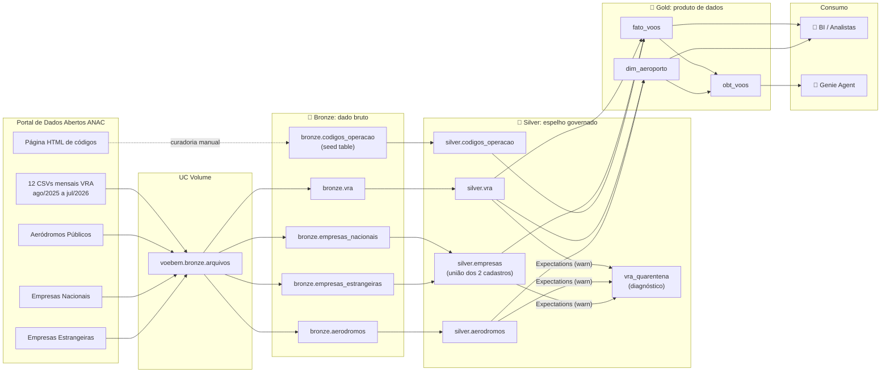
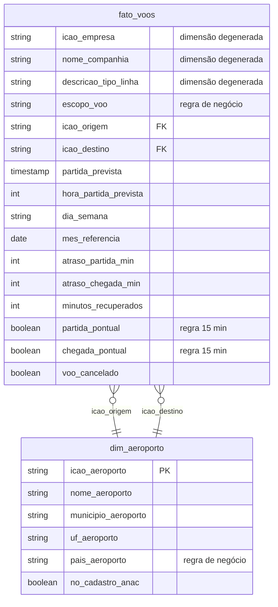

# ✈️ VoeBem Analytics — Pipeline de Dados de Voos da ANAC no Databricks


Pipeline de engenharia de dados ponta a ponta no **Databricks** sobre os **dados abertos da ANAC** (Agência Nacional de Aviação Civil) de voos operados no Brasil. Ele leva o CSV cru do portal do governo até um **produto de dados governado**, pronto para três tipos de consumidor:

- 👔 **usuários de negócio e analistas**, por meio de um modelo dimensional (**Star Schema**);
- 🤖 **um agente de IA** (o **Genie**, do Databricks AI/BI), por meio de uma **One Big Table (OBT)** desenhada para *text-to-SQL*;
- 🔍 **auditoria e compliance**, por meio de lineage, versionamento e um contrato de qualidade.

O objetivo de negócio é responder perguntas sobre **pontualidade, atrasos e cancelamentos de voos no Brasil** sob diferentes perspectivas: aeroporto, companhia, horário do dia, tipo de linha e recuperação de atraso em voo.

> [!NOTE]
> **VoeBem Analytics** é uma empresa fictícia, usada só para dar um contexto de negócio ao projeto. Os dados são reais e públicos.

---

## 📑 Sumário

1. [O problema e as perguntas de negócio](#-o-problema-e-as-perguntas-de-negócio)
2. [Arquitetura](#️-arquitetura)
3. [Fontes de dados](#-fontes-de-dados)
4. [Camada Bronze: ingestão bruta e idempotente](#-camada-bronze--ingestão-bruta-e-idempotente)
5. [Camada Silver: espelho governado](#-camada-silver--espelho-governado)
6. [Pipeline de qualidade: contrato de dados e quarentena](#-pipeline-de-qualidade--contrato-de-dados-e-quarentena)
7. [Camada Gold: Star Schema e OBT](#-camada-gold--star-schema-e-obt)
8. [Governança: metadados, tags e lineage](#️-governança--metadados-tags-e-lineage)
9. [Genie Agent: IA conversacional sobre os dados](#-genie-agent--ia-conversacional-sobre-os-dados)
10. [Conceitos aplicados (mapa para entrevistas)](#-conceitos-aplicados-mapa-para-entrevistas)
11. [Projeto em números](#-projeto-em-números)
12. [Estrutura do repositório](#-estrutura-do-repositório)
13. [Como reproduzir](#️-como-reproduzir)
14. [Armadilhas reais encontradas nos dados](#-armadilhas-reais-encontradas-nos-dados)

---

## 🎯 O problema e as perguntas de negócio

O critério de sucesso do projeto **não é "o pipeline rodou"**. É **"o produto de dados responde"**. Toda a pipeline existe para responder cinco perguntas ([docs/perguntas-de-negocio.md](docs/perguntas-de-negocio.md)):

| id | Pergunta | O que exige do modelo |
|----|----------|------------------------|
| **P1** | Quais aeroportos concentram os maiores atrasos de partida no Brasil? | atraso de partida em minutos + nome do aeroporto de origem |
| **P2** | Como o atraso evolui ao longo do dia? Quanto do atraso noturno é herdado da manhã? | hora prevista de partida + atraso médio por hora |
| **P3** | Qual companhia entrega melhor pontualidade e menor taxa de cancelamento? | nome da companhia + flag de pontualidade + situação do voo + volume |
| **P4** | Voos internacionais atrasam mais que domésticos? Quanto? | tipo de linha por extenso + atraso |
| **P5** | Quanto atraso as companhias recuperam em voo? | minutos recuperados (atraso de partida − atraso de chegada) |

**Critério de aceitação:** o Genie Agent responde corretamente às 5 perguntas, com SQL correto e **nomes legíveis** (companhias e aeroportos por nome, nunca só pelo código ICAO). Cada resposta do agente é **conferida contra uma query SQL escrita à mão** (*ground truth*).

---

## 🏛️ Arquitetura

O projeto usa a **Arquitetura Medalhão** (Bronze → Silver → Gold) dentro do **Unity Catalog**, no catálogo `voebem`. Cada camada tem uma responsabilidade única e regras explícitas do que **pode** e do que **não pode** acontecer nela.



### O princípio que organiza as camadas

| Camada | Pergunta-guia | Permitido | Proibido |
|---|---|---|---|
| 🥉 **Bronze** | *"Chegou exatamente como estava na fonte?"* | renomear colunas para nomes válidos no Delta, colunas de auditoria | tipagem, filtro, união de fontes, deduplicação |
| 🥈 **Silver** | *"Isso embute uma decisão de negócio?"* Se embute, não entra. | tipagem, separar data/hora, `COMMENT`, tags, unificar cadastros do mesmo assunto, **aritmética pura** (`real − previsto`) | `WHERE` de negócio, `GROUP BY`, limiares, flags, classificações |
| 🥇 **Gold** | *"Quem vai consumir e o que ele precisa?"* | regras de negócio (pontualidade a 15 min, escopo do voo), exclusões justificadas, desnormalização | — |

> [!IMPORTANT]
> **Filtro fecha porta.** A Silver mantém **a mesma contagem de linhas da Bronze** (1.014.705 = 1.014.705), porque toda linha descartada nela é uma pergunta que ninguém mais vai conseguir fazer. O limiar de pontualidade de 15 minutos é decisão do cliente: outro cliente pode trabalhar com 30. Se o 15 estivesse cravado na Silver, atender esse outro cliente exigiria reprocessar a camada inteira. Na Gold, é uma linha de SQL.

---

## 📦 Fontes de dados

**Fonte:** [Portal de Dados Abertos da ANAC](https://sistemas.anac.gov.br/dadosabertos/). São **15 arquivos, 137,6 MB**, com proveniência documentada (URL, tamanho em bytes e data de download) em [docs/fontes.md](docs/fontes.md).

| Conjunto | Arquivo(s) | Conteúdo | Linhas |
|---|---|---|---|
| **VRA** (Voo Regular Ativo) | `VRA_20258.csv` … `VRA_20267.csv` (12 arquivos) | uma linha por **etapa de voo**: companhia, origem, destino, horários previstos e reais, situação | 1.014.705 |
| Aeródromos Públicos | `AerodromosPublicos.csv` | cadastro de aeródromos brasileiros (ICAO → nome, município, UF) | 496 |
| Empresas Aéreas Nacionais | `pda_empresas_aereas_nacionais.csv` | cadastro de operadores nacionais | 729 |
| Empresas Aéreas Estrangeiras | `pda_empresas_aereas_estrangeiros.csv` | operadores estrangeiros autorizados no Brasil | 148 |
| Códigos de operação | *seed table* curada à mão | descrições de `codigo_di` e `codigo_tipo_linha` (a ANAC publica só em HTML) | 13 |

---

## 🥉 Camada Bronze: ingestão bruta e idempotente

📓 [notebooks/03_bronze_vra.ipynb](notebooks/03_bronze_vra.ipynb) · [notebooks/04_bronze_referencias.ipynb](notebooks/04_bronze_referencias.ipynb)

**Regras da camada:** tudo `string`, nenhuma linha descartada, colunas de auditoria e execução idempotente.

### Destaques técnicos

- **Leitura defensiva de CSV.** Cada arquivo do mesmo portal tem uma armadilha diferente:
  | Arquivo | Armadilha | Solução |
  |---|---|---|
  | VRA | 1ª linha é `Atualizado em: <data>` e carrega o BOM `EF BB BF`; separador `;` | `skipRows=1` + `header=true` + `sep=";"` |
  | Aeródromos | encoding **ISO-8859-1** ("Plácido" virava "Pl?cido") e `"` usado como símbolo de *segundos* nas coordenadas (`09°52'06"S`), o que quebrava o parser | `encoding="ISO-8859-1"` + quoting desligado com `quote=chr(0)` |
  | Empresas | UTF-8 com BOM e aspas reais (configuração oposta à do arquivo anterior) | `encoding="UTF-8"` + `quote='"'` |
- **Schema-on-read sem inferência:** `inferSchema` desligado. A Bronze não tipa.
- **Renomeação explícita e auditável** (o Delta não aceita espaço em nome de coluna). O mapeamento fica num dicionário explícito, sem `regexp_replace` mágico, e um `assert` interrompe a execução (*fail-fast*) se alguma coluna esperada sumir do CSV, o que funciona como **validação de schema** contra *schema drift*.
- **Colunas de auditoria:** `_arquivo_origem` (via coluna oculta `_metadata.file_name` do Spark) e `_ingerido_em`.
- **Idempotência por *full refresh* determinístico** (`mode("overwrite")`). Os motivos estão documentados no notebook:
  1. a fonte é **imutável e completa**: a ANAC republica o mês inteiro quando corrige algo;
  2. o VRA **não tem chave natural única**, então um `append` com deduplicação exigiria decidir regra de negócio na camada errada;
  3. o `overwrite` no Delta é **atômico** (ACID), então ninguém lê tabela pela metade;
  4. o histórico não se perde, porque cada carga vira uma versão no *transaction log*.
- **Uma tabela por arquivo de origem.** Os dois cadastros de empresas têm cabeçalho idêntico e um `UNION` "sairia de graça", mas **não é feito na Bronze**. Assim cada fonte pode ser reprocessada e comparada isoladamente. A unificação é decisão de modelagem e fica na Silver.
- **Seed table** para os códigos de operação: dado de referência pequeno, estável, curado à mão e versionado junto com o código, em vez de `CASE WHEN` espalhados pelas queries.
- **Delta Lake Time Travel** como **prova de idempotência**: `VERSION AS OF 0` vs. versão atual mostra o mesmo número de linhas e `_ingerido_em` diferente, reconstruído a partir do `DESCRIBE HISTORY`, sem nenhum código de versionamento escrito.

---

## 🥈 Camada Silver: espelho governado

📓 [notebooks/05_silver_espelho.ipynb](notebooks/05_silver_espelho.ipynb)

> **A Silver é o espelho da Bronze com governança aplicada.** Mesmo nome de tabela, mesmo grão, **mesma contagem de linhas**.

### O que foi feito

- **Medir antes de converter (*data profiling*).** Duas armadilhas foram encontradas antes de escrever o `CAST`:
  - **Ausência gravada como a string `'null'`.** `WHERE partida_real IS NULL` devolvia **zero** numa tabela com ~29 mil voos sem horário real. Correção: `nullif(col, 'null')` **antes** do cast.
  - **Dois formatos de timestamp no mesmo arquivo.** ~80 mil linhas (≈8%) têm fração de segundo de 9 casas. Um `to_timestamp` com formato fixo devolveria `NULL` em silêncio. `try_cast(... AS TIMESTAMP)` aceita os dois formatos e transforma um formato novo em `NULL` em vez de derrubar o job.
- **Tipagem e legibilidade:** timestamps quebrados em `_data` e `_hora` (`HH:mm`), altitude com vírgula decimal convertida para `DOUBLE`.
- **Aritmética pura permitida:** `atraso_partida_min`, `atraso_chegada_min` e `minutos_recuperados` são subtrações dentro da própria linha. Não têm limiar nem classificação, e por isso não fecham nenhuma análise.
- **Unificação "um assunto, dois sistemas":** `silver.empresas` = `empresas_nacionais UNION ALL empresas_estrangeiras`, com a coluna `origem_cadastro` preservando a fronteira entre as fontes. A contagem é a **soma exata** das duas (877).
- **Nomes de coluna que dizem a verdade:** a coluna `UF` do cadastro contém `"São Paulo"`, não `"SP"`. Ela foi renomeada para `uf_nome` e documentada. Inventar a sigla seria transformação de negócio.
- **Prova objetiva do marco:** `COUNT(bronze.vra) − COUNT(silver.vra) = 0`.
- **Metadados gerenciados:** `COMMENT` em **100% das colunas** (descrevendo **significado de negócio**, não tipo de dado), comentário de tabela e **tags** (`camada`, `dominio`, `fonte`, `grao`), auditados pelo `information_schema`.

---

## 🧪 Pipeline de qualidade: contrato de dados e quarentena

📂 [pipeline-qualidade-silver/](pipeline-qualidade-silver/) · implementado com **Lakeflow Declarative Pipelines** (antigo Delta Live Tables)

Um pipeline declarativo em três passos que **mede** a qualidade sem **destruir** dado:

| Passo | Arquivo | Objeto | Papel |
|---|---|---|---|
| 1 | [01_vra_marcado.sql](pipeline-qualidade-silver/01_vra_marcado.sql) | `TEMPORARY VIEW` | resolve a **integridade referencial** com `LEFT JOIN` + flags booleanas (`empresa_no_cadastro`, `origem_no_cadastro`, `destino_no_cadastro`) |
| 2 | [02_vra_auditado.sql](pipeline-qualidade-silver/02_vra_auditado.sql) | `LIVE VIEW` + 9 `EXPECT` | o **contrato de dados escrito como código** |
| 3 | [03_vra_quarentena.sql](pipeline-qualidade-silver/03_vra_quarentena.sql) | `MATERIALIZED VIEW` | **quarentena diagnóstica**: espelho dos registros reprovados, com **todos os motivos** por linha (`motivos_quarentena`) |

### As 9 expectations

| Dimensão de qualidade | Expectation |
|---|---|
| **Completude** | `horarios_previstos_presentes`, `situacao_voo_conhecida` |
| **Coerência temporal** | `chegada_prevista_depois_da_partida_prevista`, `chegada_real_depois_da_partida_real` |
| **Plausibilidade (faixa válida)** | `atraso_partida_plausivel`, `atraso_chegada_plausivel` (de −2h a +24h) |
| **Integridade referencial** | `empresa_no_cadastro_anac`, `aeroporto_origem_no_cadastro_anac`, `aeroporto_destino_no_cadastro_anac` |

### Decisões de design

- **Todas em modo `warn` (sem `ON VIOLATION`).** A escolha é de arquitetura: as expectations **medem** e publicam métricas no *event log*, e a linha continua viva. **Quem decide excluir é a Gold**, porque excluir é decisão de negócio.
- **Quarentena como diagnóstico, não como filtro.** `silver.vra` continua com 100% das linhas. A quarentena é uma lente de investigação.
- **Contornos de limitações da plataforma:**
  - expectations **não aceitam subquery**, e integridade referencial é por definição "existe na outra tabela?". A solução foi resolver o join no passo 1 e deixar a expectation olhar só a flag;
  - `TEMPORARY VIEW` **não aceita `CONSTRAINT`**, por isso o passo 2 usa `LIVE VIEW`.
- **Lógica de três valores (NULL).** Numa expectation, `NULL` conta como **reprovado**. Regras que recebem `NULL` legitimamente (voo cancelado não tem horário real) escrevem o `NULL` como aprovado de forma explícita. Sem isso, uma regra acaba medindo outra e o relatório aponta ~30 mil voos com "chegada antes da partida" que não existem.

---

## 🥇 Camada Gold: Star Schema e OBT

📂 [gold/](gold/)

É na Gold que **nascem as regras de negócio**. Ela entrega **duas modelagens** sobre o mesmo grão (**uma linha por etapa de voo**), cada uma otimizada para um consumidor:



### 👔 Star Schema (consumo humano / BI)

**[`gold.fato_voos`](gold/02_fato_voos.sql)**

- **Regras de negócio:** `partida_pontual` / `chegada_pontual` (atraso ≤ 15 min) e `escopo_voo` (Doméstico ou Internacional, derivado do tipo de linha: `N`/`C` → Doméstico, `I`/`G` → Internacional).
- **Dimensões degeneradas:** companhia e códigos de operação ficam como código + descrição no próprio fato. São poucos atributos, não mudam no tempo e o consumidor final é um LLM: *cada join a menos é um erro a menos*.
- **Atributos temporais derivados:** `hora_partida_prevista`, `dia_semana`, `mes_referencia`.
- **Fallbacks textuais** (`COMPANHIA NAO CADASTRADA (XYZ)`, `Codigo nao catalogado (1)`): coluna que a IA vai ler não pode vir `NULL`.
- **Deduplicação determinística** com `ROW_NUMBER()` nos cadastros, por defesa: se a ANAC republicar com ICAO repetido, o `LEFT JOIN` multiplicaria linhas do fato em silêncio (*fan-out*).

**Decisões sobre a quarentena:** cada categoria recebeu um tratamento justificado.

| Categoria | Registros | Decisão | Justificativa |
|---|---:|---|---|
| Aeroporto fora do cadastro ANAC | 105.932 | ✅ **Mantido** | não é dado inválido, é aeroporto estrangeiro; descartar inviabilizaria a P4 |
| Voo sem horário previsto | 30.800 | ✅ **Mantido** | o voo existiu e conta em "quantos voos"; a métrica fica `NULL` e sai das médias sozinha. *Zerar seria mentir* |
| Atraso fora da faixa plausível | 778 (partida) / 823 (chegada) | ⚠️ **Linha mantida, métrica anulada** | atrasos de até 44.855 min (31 dias) são erro de data na origem; a flag `atraso_fora_de_faixa` registra o porquê |
| Empresa sem cadastro | 69 | ✅ **Mantida** | com nome de fallback |
| Duplicata exata | 41 | ❌ **Removida** | **única exclusão de linha**: a mesma etapa publicada duas vezes inflaria voos, cancelamentos e atrasos |

➡️ Grão final: **1.014.705 − 41 = 1.014.664** linhas.

**[`gold.dim_aeroporto`](gold/01_dim_aeroporto.sql)**: **dimensão com dois papéis** (*role-playing dimension*), que atende origem **e** destino.

- **A dimensão nasce do fato, não do cadastro.** Copiar `silver.aerodromos` daria 496 linhas e deixaria **218 aeroportos do fato órfãos** (os estrangeiros, que a ANAC não cadastra). A lista de chaves vem do fato e o cadastro **enriquece** por `LEFT JOIN`, o que dá **100% de cobertura do fato**.
- `pais_aeroporto` (Brasil/Exterior) é derivado do **prefixo ICAO** (`^S[BDIJNSW]`). É interpretação, não aritmética, por isso fica na Gold e não na Silver.

### 🤖 OBT: One Big Table (consumo por IA)

**[`gold.obt_voos`](gold/03_obt_voos.sql)**: fato + dimensão (duas vezes) já resolvidos em uma única tabela larga.

> **Regra de ouro:** nenhuma coluna de código sem a coluna de descrição ao lado. O LLM lê nome, não código ICAO. E o único join que ela exige de quem consome é **nenhum**.

Por que uma OBT para a IA? Em *text-to-SQL*, cada `JOIN` que o modelo precisa inferir é uma chance de erro (chave errada, *fan-out*, cardinalidade mal interpretada). Desnormalizar transfere essa complexidade do momento da pergunta, que é probabilístico, para o pipeline, que é determinístico e testado.

---

## 🛡️ Governança: metadados, tags e lineage

📓 [notebooks/06_governanca_gold.ipynb](notebooks/06_governanca_gold.ipynb)

> Quando o consumidor é uma IA, metadado deixa de ser documentação e vira **requisito funcional**. O `COMMENT` é o texto que o modelo lê para escolher qual coluna usar. Coluna mal descrita é coluna usada errado, e o erro chega formatado e com número.

- **100% das colunas documentadas** em Silver e Gold (`obt_voos`: 39 · `fato_voos`: 31 · `dim_aeroporto`: 7 · `silver.vra`: 26), com cobertura **auditada via `information_schema.columns`**, porque "documentei tudo" é afirmação e o catálogo é o fato.
- **Tags de catálogo** (`camada`, `dominio`, `consumo`, `grao`, `padrao`) para descoberta e políticas. Exemplo: `consumo = genie` vs. `consumo = bi`.
- **Revisão humana das descrições geradas por IA (*human-in-the-loop*).** O rascunho da IA para `minutos_recuperados` dizia *"valor positivo indica que o voo chegou adiantado"*. A frase soava perfeita e **estava errada**. O dado mostrou que **164.895 voos recuperaram tempo e mesmo assim chegaram atrasados**, 75.082 deles com mais de 15 min. Outras duas afirmações do rascunho também foram derrubadas pelo dado:

  | Rascunho da IA | O dado diz |
  |---|---|
  | "`partida_pontual = false` inclui os cancelados" | cancelado tem `partida_pontual` `NULL`: 29.140 de 29.140 |
  | "`mes_referencia` é o mês de todo voo" | é `NULL` em 30.798 voos, os sem horário previsto |

- **Lineage automático** pelo Unity Catalog (`system.access.table_lineage`), sem nenhuma linha de código de rastreabilidade:
  `CSV no Volume → bronze.vra → silver.vra → gold.fato_voos → gold.obt_voos`
  O grafo responde à pergunta de **análise de impacto** (*"se eu mexer aqui, o que quebra lá na frente?"*) e à de **proveniência/compliance** (*"esse número veio de onde?"*).

---

## 🤖 Genie Agent: IA conversacional sobre os dados

📂 [genie/](genie/)

O **Databricks AI/BI Genie** foi configurado como um "analista de dados virtual" da VoeBem, capaz de responder em linguagem natural com SQL gerado sobre a `obt_voos`. A configuração tem duas peças:

### 1. System instructions: a camada semântica do agente

[genie/system_instructions.txt](genie/system_instructions.txt) codifica as **definições de negócio** e as **guardrails** que o modelo não conseguiria deduzir sozinho:

| Tema | Instrução | Erro que ela evita |
|---|---|---|
| **Fonte única** | use sempre `obt_voos`, nunca faça `JOIN` | joins inventados, *fan-out* |
| **Pontualidade** | use as flags prontas, não recalcule o limiar | divergência de definição de métrica |
| **Atrasado** | `partida_pontual = false`, nunca `NOT` nem `ELSE` | contar `NULL` (cancelados) como atraso |
| **Percentual** | denominador = voos **que têm a métrica**, com `try_divide` | percentual inflado; divisão por zero |
| **Cancelados** | fora de médias de atraso; só entram na taxa de cancelamento | médias distorcidas |
| **Rankings** | `HAVING COUNT(*) >=` 10.000 (companhias), 5.000 (aeroportos), 2.000 (rotas), informando o corte na resposta | **viés de amostra pequena** (uma companhia com 12 voos liderando tudo) |
| **Nomes** | sempre exibir nome, nunca só o código ICAO | respostas ilegíveis para humanos |
| **Escopo geográfico** | "aeroportos" sem país significa `pais_origem = 'Brasil'` | aeroporto estrangeiro liderando ranking "do Brasil" |
| **Duas dimensões** | responder uma por vez, nunca `UNION` de agrupamentos diferentes | SQL inválido |
| **Ambiguidade** | "porte" = volume de voos (`COUNT(*)`) | interpretação livre do LLM |
| **Dados ausentes** | explica por que estrangeiros não têm município/UF | alucinação para preencher lacunas |

### 2. Example queries: *few-shot* com SQL de referência

Cinco queries curadas ([01](genie/01_query_example.sql) · [02](genie/02_query_example.sql) · [03](genie/03_query_example.sql) · [04](genie/04_query_example.sql) · [05](genie/05_query_example.sql)), uma por pergunta de negócio. Elas ensinam ao agente os padrões corretos (denominador, corte por volume, filtros) e servem como **ground truth** na avaliação das respostas.

```sql
-- P1: Quais aeroportos do Brasil concentram os maiores atrasos de partida?
SELECT nome_aeroporto_origem, municipio_origem, uf_origem,
       COUNT(*) AS voos,
       ROUND(AVG(atraso_partida_min), 2) AS atraso_medio_min,
       ROUND(100.0 * try_divide(SUM(CASE WHEN partida_pontual = false THEN 1 ELSE 0 END),
                                SUM(CASE WHEN partida_pontual IS NOT NULL THEN 1 ELSE 0 END)), 2) AS pct_atrasados
FROM voebem.gold.obt_voos
WHERE pais_origem = 'Brasil'
GROUP BY 1, 2, 3
HAVING COUNT(*) >= 5000
ORDER BY pct_atrasados DESC
LIMIT 10
```

---

## 🧠 Conceitos aplicados (mapa para entrevistas)

### 🔧 Engenharia de Dados

| Conceito | Onde aparece no projeto |
|---|---|
| **Arquitetura Medalhão** | Bronze/Silver/Gold com regras de permitido e proibido por camada |
| **Lakehouse / Delta Lake** | todas as tabelas em formato Delta sobre o Unity Catalog |
| **Transações ACID** | `overwrite` atômico, sem leitura parcial |
| **Idempotência** | *full refresh* determinístico na Bronze, provado com time travel |
| **Time Travel e versionamento** | `DESCRIBE HISTORY`, `VERSION AS OF 0` |
| **Schema-on-read / dado bruto imutável** | Bronze 100% `string`, sem inferência de schema |
| **Validação de schema (*fail-fast*)** | `assert` das colunas esperadas antes da escrita |
| **Colunas de auditoria e proveniência** | `_arquivo_origem`, `_ingerido_em`, `_transformado_em`, `_processado_em` |
| **Tratamento de encoding e formatos** | ISO-8859-1 vs. UTF-8 com BOM, quoting desligado, `skipRows` |
| **Ingestão via Volumes** | `/Volumes/voebem/bronze/arquivos/` |
| **Seed tables** | `codigos_operacao`, curada e versionada com o código |
| **Separação de responsabilidades** | regras de negócio só na Gold; Silver sem decisões |
| **Tipagem robusta** | `nullif` + `try_cast` para nulos textuais e formatos mistos |
| **Pipelines declarativos** | Lakeflow Declarative Pipelines (`LIVE VIEW`, `MATERIALIZED VIEW`) |
| **Deduplicação determinística** | `ROW_NUMBER() OVER (PARTITION BY ...)` |
| **Proteção contra *fan-out* em joins** | deduplicação defensiva dos cadastros antes do `LEFT JOIN` |

### ✅ Qualidade e Governança de Dados

| Conceito | Onde aparece no projeto |
|---|---|
| **Data Contracts** | 9 expectations versionadas como código |
| **Dimensões de qualidade** | completude, validade, consistência temporal, plausibilidade, integridade referencial, unicidade |
| **Quarentena (diagnóstica)** | `vra_quarentena` com os motivos por registro, sem remover dados |
| **Observabilidade de qualidade** | métricas das expectations publicadas no *event log* |
| **Reconciliação de contagens** | Bronze = Silver; Silver − 41 = Gold; soma dos cadastros = `silver.empresas` |
| **Tratamento de outliers** | linha mantida, métrica anulada + flag explicativa |
| **Semântica de NULL** | lógica de três valores tratada nas expectations, nas métricas e nas instruções do agente |
| **Unity Catalog** | namespace de 3 níveis (`catálogo.schema.tabela`), Volumes |
| **Metadados de negócio** | `COMMENT` em 100% das colunas, auditado via `information_schema` |
| **Tags / Data Discovery** | tags por camada, domínio, fonte, grão, padrão e consumidor |
| **Data Lineage** | `system.access.table_lineage` (análise de impacto e proveniência) |
| **Proveniência das fontes** | [docs/fontes.md](docs/fontes.md) com URL, bytes e timestamp de download |

### 📊 Analytics e Modelagem

| Conceito | Onde aparece no projeto |
|---|---|
| **Modelagem dimensional (Kimball)** | `fato_voos` + `dim_aeroporto` |
| **Definição de grão** | uma linha por etapa de voo, declarada e preservada em todas as camadas |
| **Dimensão degenerada** | companhia e códigos de operação dentro do fato |
| **Dimensão com dois papéis (*role-playing*)** | `dim_aeroporto` atendendo origem e destino |
| **Dimensão derivada do fato** | chaves vindas do fato, cadastro só enriquece (100% de cobertura) |
| **One Big Table (OBT)** | `obt_voos`, desnormalizada para consumo por IA |
| **Métricas e KPIs de negócio** | % de pontualidade (≤15 min), taxa de cancelamento, atraso médio, minutos recuperados |
| **Denominador correto** | percentuais calculados só sobre voos que têm a métrica |
| **Viés de amostra pequena** | corte mínimo de volume (`HAVING`) em todo ranking |
| **Atributos temporais** | hora do dia, dia da semana, mês de referência |
| **Problem-first / requisitos de negócio** | 5 perguntas como critério de aceitação do produto |

### 🤖 IA e Agentes (AI-Ready Data)

| Conceito | Onde aparece no projeto |
|---|---|
| **Text-to-SQL / NL2SQL** | Genie gerando SQL a partir de linguagem natural |
| **Camada semântica para LLM** | definições de negócio nas *system instructions* |
| **Prompt engineering / guardrails** | regras de denominador, NULL, `UNION`, escopo geográfico |
| **Few-shot learning** | 5 *example queries* curadas |
| **Dados prontos para IA (AI-ready)** | OBT sem joins, nomes legíveis, fallbacks textuais, sem `NULL` em colunas de exibição |
| **Metadado como contexto do modelo** | `COMMENT` de coluna lido pelo agente para escolher colunas |
| **Human-in-the-loop** | revisão das descrições geradas por IA contra o dado |
| **Mitigação de alucinação** | validação empírica de afirmações e instruções explícitas para dados ausentes |
| **Avaliação de agentes (*ground truth*)** | respostas do Genie comparadas a SQL escrito à mão |

---

## 📈 Projeto em números

| Métrica | Valor |
|---|---:|
| Janela temporal | ago/2025 → jul/2026 (12 meses) |
| Arquivos de origem | 15 (137,6 MB) |
| Etapas de voo na Bronze / Silver | 1.014.705 |
| Etapas de voo na Gold | 1.014.664 |
| Registros diagnosticados na quarentena | 213.543 |
| Linhas removidas em todo o pipeline | **41** (duplicatas exatas) |
| Expectations no contrato de dados | 9 |
| Aeroportos estrangeiros recuperados pela dimensão | 218 |
| Voos cancelados | 29.140 |
| Cobertura de `COMMENT` em Silver e Gold | 100% |

---

## 📁 Estrutura do repositório

```
projeto_databricks_anac/
├── 00_preparar_ambiente.sql          # catálogo, schemas (bronze/silver/gold) e volume no Unity Catalog
├── dados/
│   ├── vra/                          # 12 CSVs mensais do VRA (ANAC)
│   └── referencias/                  # aeródromos e cadastros de empresas aéreas
├── docs/
│   ├── fontes.md                     # proveniência: URL, bytes e data de download de cada arquivo
│   └── perguntas-de-negocio.md       # as 5 perguntas e o critério de aceitação
├── notebooks/
│   ├── 03_bronze_vra.ipynb           # ingestão idempotente do VRA
│   ├── 04_bronze_referencias.ipynb   # cadastros + seed table + Delta history/time travel
│   ├── 05_silver_espelho.ipynb       # tipagem, unificação, comentários e tags
│   └── 06_governanca_gold.ipynb      # revisão de metadados, tags e lineage da Gold
├── pipeline-qualidade-silver/        # Lakeflow Declarative Pipeline
│   ├── 01_vra_marcado.sql            # flags de integridade referencial
│   ├── 02_vra_auditado.sql           # contrato de dados (9 expectations)
│   └── 03_vra_quarentena.sql         # quarentena diagnóstica
├── gold/
│   ├── 01_dim_aeroporto.sql          # dimensão com dois papéis (origem/destino)
│   ├── 02_fato_voos.sql              # fato + regras de negócio + decisões da quarentena
│   └── 03_obt_voos.sql               # One Big Table para o Genie
└── genie/
    ├── system_instructions.txt       # camada semântica e guardrails do agente
    └── 0X_query_example.sql          # example queries (P1 a P5)
```

---

## ▶️ Como reproduzir

> [!TIP]
> Um workspace Databricks com **Unity Catalog** e permissão para criar catálogo é suficiente (por exemplo, a *Databricks Free Edition*).

1. **Ambiente:** execute [00_preparar_ambiente.sql](00_preparar_ambiente.sql) para criar o catálogo `voebem`, os schemas `bronze`/`silver`/`gold` e o volume `voebem.bronze.arquivos`.
2. **Upload dos dados:** envie `dados/vra/*.csv` para `/Volumes/voebem/bronze/arquivos/vra/` e `dados/referencias/*.csv` para `/Volumes/voebem/bronze/arquivos/referencias/`.
3. **Bronze:** execute [03_bronze_vra.ipynb](notebooks/03_bronze_vra.ipynb) e depois [04_bronze_referencias.ipynb](notebooks/04_bronze_referencias.ipynb).
4. **Silver:** execute [05_silver_espelho.ipynb](notebooks/05_silver_espelho.ipynb).
5. **Qualidade:** crie um **ETL Pipeline** com os três arquivos de [pipeline-qualidade-silver/](pipeline-qualidade-silver/), com destino `voebem.silver`, e execute.
6. **Gold:** execute em ordem [01_dim_aeroporto.sql](gold/01_dim_aeroporto.sql) → [02_fato_voos.sql](gold/02_fato_voos.sql) → [03_obt_voos.sql](gold/03_obt_voos.sql).
7. **Governança:** execute [06_governanca_gold.ipynb](notebooks/06_governanca_gold.ipynb).
8. **Genie:** crie um *Genie Agent* sobre `voebem.gold.obt_voos`, cole [system_instructions.txt](genie/system_instructions.txt) nas instruções e cadastre as cinco *example queries*. Valide as respostas às perguntas P1 a P5 contra as queries de referência.

---

## 🪤 Armadilhas reais encontradas nos dados

Alguns achados que mostram por que **medir antes de transformar** importa:

- 🔤 **"Plácido de Castro" virando "Pl?cido de Castro"**: arquivo em latin-1 num portal que também publica em UTF-8.
- 📍 **Aspas que não eram aspas**: `"` usado como símbolo de segundos em coordenadas fazia o parser engolir várias linhas.
- 🫥 **`NULL` que não era `NULL`**: a string `'null'` fazia `IS NULL` retornar zero numa base com ~29 mil ausências.
- 🕐 **Dois formatos de timestamp no mesmo arquivo**: um parser com formato fixo anularia 8% da base em silêncio.
- 🗂️ **Arquivo corrompido na origem**: um `pda_empresas_aereas_nacionais.csv` de 144 MB na raiz do portal, com o cadastro repetido centenas de vezes. A versão correta está na subpasta.
- 🏷️ **Coluna `UF` com nome por extenso**: `WHERE uf = 'SP'` retornaria zero linhas.
- ✈️ **Só 20 das 729 empresas nacionais têm ICAO**: o cadastro é dominado por aviação agrícola, táxi aéreo e aeroclubes.
- ⏱️ **Atraso de 31 dias**: erro de data na origem, tratado como métrica inválida sem perder o voo.
- 📜 **`codigo_justificativa` sempre vazio**: deixou de ser exigido com a revogação da IAC 1504 em 2020.
- 🤖 **IA descrevendo uma métrica de forma convincente e errada**: corrigido com uma query contra o dado.

---

## 📫 Contato
  
Vamos nos conectar!

-   **LinkedIn:** [danilo-souza-reis](https://www.linkedin.com/in/danilo-souza-reis-ab61761b6/)
-   **GitHub:** [@danilo-s-reis](https://github.com/danilo-s-reis)
-   **Email:** [reis.souza.danilo@hotmail.com](mailto:reis.souza.danilo@hotmail.com)  

---

<p align="center">
  Dados públicos: <a href="https://sistemas.anac.gov.br/dadosabertos/">ANAC — Dados Abertos</a> · Construído com Databricks, Delta Lake, Unity Catalog e AI/BI Genie
</p>
